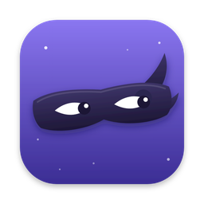

<p align="center">
  
</p>

<h1 align="center">Memory Sneak</h1>

<p align="center">
  <a href="https://github.com/boroughandbolt/MemorySneak/actions/workflows/build.yml"></a>
  <a href="https://github.com/boroughandbolt/MemorySneak/releases/latest"></a>
</p>

<p align="center">
  A tiny menu bar app that keeps an eye on your Mac's memory, so you see trouble coming <em>before</em> the "Your system has run out of application memory" window shows up.<br>
  It also knows when you're gaming, including Windows games running through Wine, and gets out of your way.
</p>

> [!IMPORTANT]
> **Xcode is required for Game Mode for Wine games.** That feature uses Apple's `gamepolicyctl` tool, which only comes with the free [Xcode](https://apps.apple.com/us/app/xcode/id497799835) app. Everything else in Memory Sneak works without Xcode.
> You can [download a ready-made copy](#option-1-download-it) of the app, or [build it yourself](#option-2-build-it-with-xcode) with Xcode.

---

## What it does

Memory Sneak lives in your menu bar as a colored dot and a percentage, like `🟢 68%`. Click it to open a small panel with everything you need to know.

### Watches your memory the way macOS actually works

Macs keep memory nearly full on purpose, so a high number doesn't mean anything is wrong. Memory Sneak looks at the signs that *do* matter:

- **Memory pressure:** how hard macOS is working to find room. This is the same measure Activity Monitor uses.
- **Swap:** memory that has spilled onto your disk because RAM ran out.
- **Free disk space:** your Mac uses free disk space as overflow memory. When the disk is nearly full, you can hit the out-of-memory window even with plenty of RAM. This is one of the most common causes, and most memory apps ignore it.

Those three add up to a simple status:

| Dot | Means | When |
|---|---|---|
| 🟢 Green | All good | Memory pressure is normal, swap is modest and you have more than 20 GB free on disk |
| 🟠 Orange | Getting tight | Memory pressure is elevated, swap is bigger than your RAM, **or** less than 20 GB is free on disk |
| 🔴 Red | Close apps now | Memory pressure is critical, swap is more than twice your RAM, **or** less than 5 GB is free on disk |

### Shows you what's using it

- **A 10-minute graph** of memory use, so you can see if something is creeping up.
- **The apps using the most memory**, with each app's helper processes counted together. For example, every Chrome helper shows up as one "Google Chrome" line. Hover over an app to get a **Quit** button, which asks you to save your work like quitting normally does.
- **A suggestion when things get tight**, like "Quitting Xcode would free about 1.3 GB", with a Quit button right next to it. Parts of macOS like Finder and the Dock are never suggested, and neither is a game you're playing.

### Warns you, without nagging

When the status gets worse, Memory Sneak sends a notification that says what's wrong and which app to quit. If things stay orange or red, it reminds you every 30 minutes at most.

### Gaming mode

Memory Sneak notices when you're playing and adjusts:

- **Quiet while gaming:** no notifications while a game is running. The menu bar dot turns into a 🎮, and a banner in the panel shows what you're playing.
- **Finds Windows games running through Wine:** this works with **Sikarugir, CrossOver, Whisky and Wineskin**. It looks at what Wine is actually running and uses Steam's own name for the game, so you'll see "Marvel Rivals" instead of a Wine process name. Launchers like Steam, Epic and Battle.net, installers, and Wine's own background programs don't count as games.
- **Finds native Mac games too:** any app that macOS lists as a game, or that's installed through Steam.

### Game Mode for Wine games

macOS Game Mode gives a game top priority for your CPU and graphics, and it doubles the Bluetooth sampling rate so AirPods and controllers lag less. macOS turns it on by itself for Mac games, but it usually **can't tell that a Wine game is a game**, so Game Mode never kicks in.

Memory Sneak fixes that. When it sees a Wine game start, it turns Game Mode on with Apple's own `gamepolicyctl` tool, which comes with Xcode. About 15 seconds after the game closes, or when you quit Memory Sneak, it hands Game Mode back to macOS. If Memory Sneak is closed unexpectedly while Game Mode is forced on, it hands it back the next time it opens.

A few things to know:

- Game Mode is a **whole-Mac** setting while it's forced on. Some Spotlight features may pause while it's on, so searches may be a little limited.
- The macOS game controller icon doesn't always appear in the menu bar for Wine games, even when Game Mode is on. Check Memory Sneak's banner instead: it says **Game Mode on**, or shows an error in red if something went wrong.
- Game Mode needs a Mac with Apple silicon.

### Settings

All in the panel:

- **Open at login**
- **Quiet while gaming** (on by default)
- **Game Mode for Wine games** (on by default; grayed out if Xcode isn't installed)

---

## Requirements

- **macOS 14 Sonoma or later**
- **Xcode** (free from the Mac App Store), for Game Mode for Wine games and for building it yourself. Not needed just to use the memory monitor.
- **A Mac with Apple silicon**, for Game Mode. The memory monitor works on Intel Macs too.

## Install

### Option 1: Download it

1. Go to the [**latest release**](https://github.com/boroughandbolt/MemorySneak/releases/latest) and download `MemorySneak-v….zip` under **Assets**.
2. Double-click the zip to unzip it, then drag **MemorySneak** into your **Applications** folder.
3. Open it. The first time, macOS will say it can't check the app for malicious software. That's because Memory Sneak isn't signed with a paid Apple Developer account, not because anything is wrong with it. To open it anyway:
   - Click **Done** in that message.
   - Open **System Settings → Privacy & Security**, scroll down and click **Open Anyway** next to Memory Sneak.
   - Confirm with your password or Touch ID.

   You only have to do this once. If you'd rather not, build it yourself instead (Option 2). Apps you build with your own Xcode open without the warning.

Every copy on the Releases page is built automatically by GitHub from the code in this repo, so what you download is exactly what you see here.

### Option 2: Build it with Xcode

1. Install **Xcode** from the Mac App Store and open it once so it can finish setting up.
2. Download this project: click the green **Code** button, then **Download ZIP**, and unzip it. Or clone it:
   ```bash
   git clone https://github.com/boroughandbolt/MemorySneak.git
   ```
3. Double-click **`MemorySneak.xcodeproj`** to open it in Xcode.
4. Make sure the destination at the top of the Xcode window says **My Mac**, then click the **Run ▶︎** button.

That's it. Xcode builds Memory Sneak, copies it into your **Applications** folder as `MemorySneak.app` and starts it. Look for the dot and percentage in your menu bar. You don't need to keep Xcode open afterward.

**First launch:**
- Click **Allow** when it asks to send notifications. That's how the warnings reach you.
- Turn on **Open at login** in the panel if you want it running all the time.

**Updating:** download the newest release and replace the old app in Applications, or, if you build it yourself, download the new code and click **Run ▶︎** again.

**Uninstalling:** click **Quit Memory Sneak** in the panel, then drag `MemorySneak.app` from Applications to the Trash.

---

## FAQ

**Why isn't there a "Clean memory" button?**
Because those buttons don't really help. macOS deliberately keeps recently used things in memory so they open faster, and gives that memory up as soon as something else needs it. Force-clearing it just makes your Mac reload everything, and the number climbs right back up. The only thing that actually frees memory is quitting an app that's using it, which is why Memory Sneak tells you *which* app to quit.

**Does it send any data anywhere?**
No. Memory Sneak has no network code at all. Everything it shows is read from your own Mac, and nothing leaves it.

**My game wasn't detected / a launcher was treated like a game.**
Please [open an issue](../../issues) with the game's name and how you're running it (Sikarugir, CrossOver, Whisky…). Detection is based on the name of the Windows program, so a quick report is usually enough to fix it.

**It says Game Mode needs Xcode, but I have Xcode.**
Memory Sneak looks for Xcode at `/Applications/Xcode.app` (or `Xcode-beta.app`). If yours lives somewhere else, move it into Applications.

**Is it on the App Store?**
No, and it can't be. App Store apps aren't allowed to look at other apps' processes or change Game Mode, and those are the things that make Memory Sneak useful.

---

## How it works (for the curious)

- Memory use comes from the kernel's VM statistics (`host_statistics64`): app memory, wired memory and compressed memory. Memory pressure comes from `kern.memorystatus_vm_pressure_level`, swap from `vm.swapusage`, and per-app use from each process's physical footprint, the same number Activity Monitor shows.
- Wine games are found by looking for Wine processes and reading which Windows `.exe` each one is running. Game names come from Steam's `appmanifest` files inside the Wine prefix, with the game's folder name as a backup.
- Game Mode is switched with `gamepolicyctl game-mode set on` and `set auto`.
- It's written in SwiftUI with no third-party code. It checks your Mac every 5 seconds.
